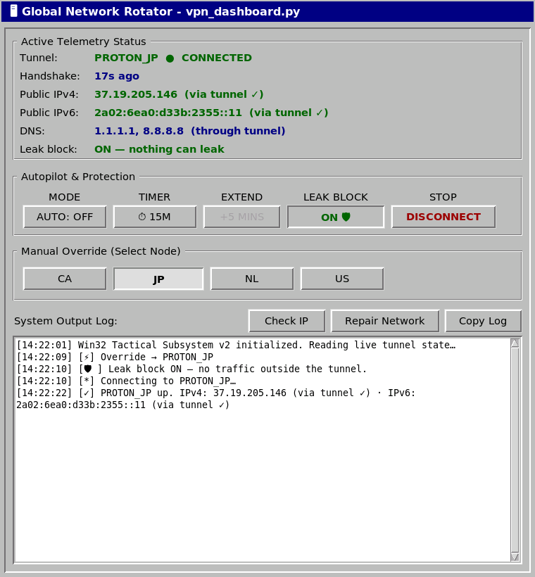

# 🪟 Leakproof VPN Rotator

A lightweight, retro-styled Python control center for WireGuard VPNs on cyberdecks and Linux field units (built on a Raspberry Pi 5 with ProtonVPN configs). Classic Win95 look; modern leak protection underneath.

## 🚀 Features

* **Real kill switch (LEAK BLOCK):** an nftables rule set drops every packet that isn't going through the tunnel (LAN and Tailscale still work). It stays on while switching servers and if the tunnel dies, so your real IP can't leak. DISCONNECT lifts it.
* **Leak-free rotation:** autopilot (5/15/30/60 min) or one-click server override, with the block held during the switch.
* **Live, honest telemetry:** tunnel state and last WireGuard handshake come from the kernel (`wg show`), not a saved file. Public IPv4 *and* IPv6 are checked by route: *via tunnel ✓*, *blocked*, or *⚠ LEAK*.
* **IPv6 leak fix:** configs route `::/0` into the tunnel (servers without IPv6 simply block it).
* **DNS stays in the tunnel:** on connect, `/etc/resolv.conf` is pointed at the VPN's own resolver (the config's `DNS =`); your original is restored on disconnect. So lookups use the VPN's DNS instead of silently falling back to a public resolver — and the original is backed up persistently, so a crash can't strand you on an unreachable tunnel resolver.
* **Keys never on disk in plaintext:** private keys live in the hardware-locked vault from [LLM-Token-Vault](https://github.com/4rch0n-c0c0nu7/LLM-Token-Vault); configs are templates with `PrivateKey = VAULT_INJECT`, and the live config is piped straight to the root helper (kept only in root-only RAM while connected).
* **Least privilege:** the GUI runs as your user. The only root step is `vpnctl`, a small root-owned helper that sudo allows by itself — no `sudo python3 <user-writable script>`. It refuses configs containing `PostUp`/`PreUp`-style hooks.
* **Crash-safe:** if the app is hard-killed while connected, a left-over kill switch *or* DNS override is detected and reverted on the next launch — a crash can't leave you silently offline or mis-resolving.

## 🛠️ Components (`vpn-rotator/`)

* `vpn_dashboard.py` — the Win95-styled GUI.
* `vpn_rotator.py` — rotation logic + CLI (`python3 vpn_rotator.py [name|--down|--status]`), cron-friendly.
* `vpnctl` — root helper: `up NAME` (config on stdin) · `down` · `lock on|off` · `status` · `netreset`.
* `sudoers-vpnctl.example` — the one sudo rule it needs.

## ⚙️ Setup

```bash
git clone https://github.com/4rch0n-c0c0nu7/Leakproof-VPN-Rotator.git && cd Leakproof-VPN-Rotator/vpn-rotator
sudo install -o root -g root -m 0755 vpnctl /usr/local/sbin/vpnctl
sed "s/^dano /$USER /" sudoers-vpnctl.example > /tmp/020_vpnctl && sudo visudo -cf /tmp/020_vpnctl \
  && sudo install -o root -g root -m 0440 /tmp/020_vpnctl /etc/sudoers.d/020_vpnctl
```

The dashboard loads your keys through the encrypted vault from [LLM-Token-Vault](https://github.com/4rch0n-c0c0nu7/LLM-Token-Vault). Clone it to `~/LLM-Token-Vault` so `lumi_vault.py` is importable — `vpn_rotator.py` loads it from there, keeping the vault code in one repo instead of copied into this one:

```bash
git clone https://github.com/4rch0n-c0c0nu7/LLM-Token-Vault ~/LLM-Token-Vault
```

1. Put WireGuard templates in `~/vpn_configs/NAME.conf` with `PrivateKey = VAULT_INJECT`, `AllowedIPs = 0.0.0.0/0, ::/0`, and your provider's `DNS =` (Proton: `10.2.0.1`).
2. Store each private key in the vault as `VPN_KEY_NAME` (e.g. `VPN_KEY_proton_us`).
3. Run `python3 vpn_dashboard.py`.

Requires `wireguard-tools`, `nftables`, `curl`, `python3-tk`, `cryptography`.

**Never commit** `*.log` or state files — they can contain your real public IP (`.gitignore` covers this).
